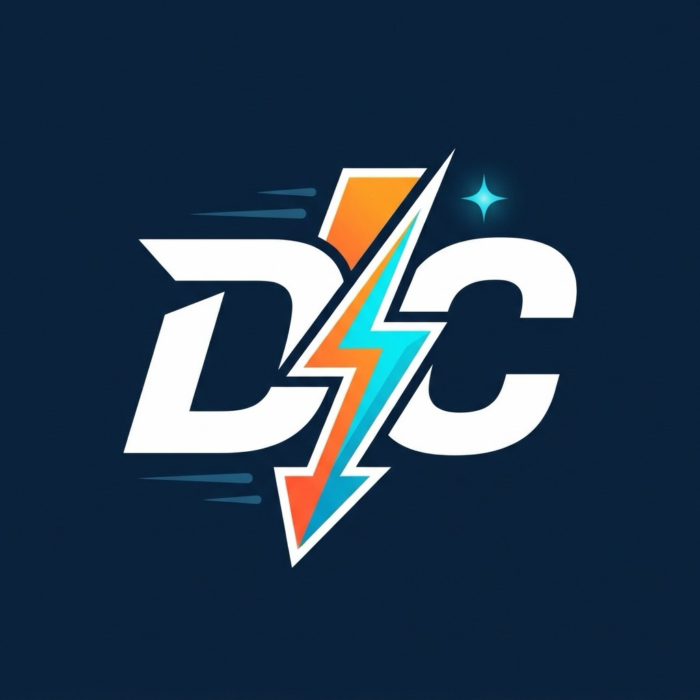
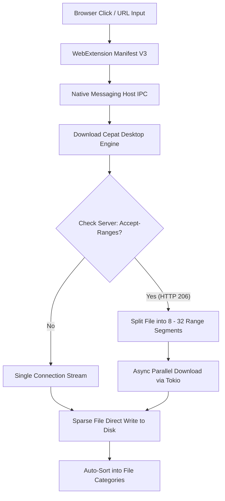

<div align="center">
  <p>🌐 <strong>Language:</strong> English | <a href="README.id.md">Bahasa Indonesia</a></p>

  
  <h1>Download Cepat ⚡</h1>
  <p><strong>A Modern, Cross-Platform Multi-Thread Download Accelerator & Manager (macOS, Windows & Linux)</strong></p>
  <p>Officially developed by <strong>Ujang Mustamar</strong></p>

  <p>
    <a href="https://github.com/moesstudio/download-cepat/releases">
      
    </a>
    
    
    
    
    
    
    
  </p>

  <p>
    <a href="https://github.com/moesstudio/download-cepat/releases/latest"><strong>📥 Download Installer</strong></a> •
    <a href="https://chromewebstore.google.com/detail/lmahadjehdfibjjgcnbajbgapbkghida?utm_source=item-share-cb"><strong>🌐 Chrome Extension</strong></a> •
    <a href="#-key-features"><strong>✨ Features</strong></a> •
    <a href="#-system-architecture"><strong>🏛️ Architecture</strong></a>
  </p>
</div>

---

<!-- Uncomment the block below once you upload your app screenshot or GIF to public/preview.png -->
<!--
<div align="center">
  
</div>
-->

## 📖 About Download Cepat

*(Fun fact: "Download Cepat" literally means "Fast Download" in Indonesian.)*

**Download Cepat** is a modern, open-source desktop download manager powered by **Rust (`tokio` + `reqwest`)**, **Tauri v2**, and **React 19 (TypeScript & Tailwind CSS)**. It is engineered to solve the common pain points of traditional and bloatware-heavy download managers:

- **True Cross-Platform Support**: Runs natively on **macOS (Universal: Apple Silicon M1–M4 & Intel)**, **Windows 10/11**, and **Linux**.
- **Ultra-Lightweight & Resource-Efficient**: Consumes under **40 MB of RAM** with a release binary size of just **~4.4 MB** (no bloated Electron memory overhead).
- **Maximum Bandwidth Utilization**: Splits files into 8 to 32 concurrent HTTP Range segments in parallel to saturate your available internet speed.
- **100% Free & Ad-Free**: No intrusive ads, no telemetry, and no fake serial number pop-ups.

---

## ✨ Key Features

* 🚀 **Multi-Connection Segmented Download**: Accelerates downloads by opening 8 to 32 simultaneous HTTP Range connections.
* 🛡️ **Smart Pause & Resume**: Safely resume interrupted downloads anytime without file corruption using strict `If-Range` & `ETag` header validation.
* ⚡ **Pre-Allocated Sparse File Assembly**: Writes incoming chunks directly to their final byte offsets on disk (zero-copy), preventing system freezes when completing massive multi-gigabyte files.
* 🌐 **Manifest V3 Browser Extension**: Automatically intercepts downloads across Google Chrome, Microsoft Edge, Brave, and Firefox via Native Messaging IPC.
* 🎥 **Floating Video Grabber**: Automatically injects a floating download button over HTML5 streaming videos.
* 📊 **Segmented Progress Bar & Real-Time Canvas Graph**: Dynamic per-segment progress visualization alongside a live Mbps speed curve graph.
* 📁 **Automatic File Categorization**: Automatically organizes completed downloads into dedicated folders (*Compressed*, *Documents*, *Music*, *Programs*, *Video*).
* 🎛️ **Smart Speed Limiter**: Throttle download speeds on the fly so your browsing, streaming, or gaming stays smooth.
* 🌍 **Multi-Language Interface**: Available in English, Bahasa Indonesia, Bahasa Melayu, and 日本語.
* 🪪 **Official Build Info**: Transparent release panel displaying MIT license details, engine version, and official attribution to **Ujang Mustamar**.
* 🌙 **Dark & Light Mode**: Clean, modern interface adhering to WCAG 2.2 AA accessibility standards.

---

## 📦 Download Desktop Installer (macOS, Windows, Linux)

👉 **[Download the Latest Release from GitHub Releases](https://github.com/moesstudio/download-cepat/releases/latest)**

The official **Download Cepat** desktop app is compiled using **Tauri v2 + Rust Core**, resulting in a tiny installer (~3.2 MB) and minimal memory footprint (< 40 MB RAM):

| Operating System | Installer Format | Architecture & Details |
| :--- | :--- | :--- |
| 🍏 **macOS** | `.dmg` / `.app` | Universal Binary for Apple Silicon (M1–M4) & Intel x86_64 |
| 🪟 **Windows** | `.exe` (NSIS Setup) / `.msi` | Windows 10 & 11 (64-bit) with clean auto-uninstaller |
| 🐧 **Linux** | `.AppImage` / `.deb` | Universal portable package for Ubuntu, Debian, Fedora, Arch |

*(Note: If Windows SmartScreen or macOS Gatekeeper shows an unrecognized developer warning because the open-source binary isn't code-signed yet, click **More info → Run anyway** on Windows, or right-click → **Open** on macOS).*

### 🛠️ Building Desktop Installers Locally
```bash
# Build the desktop application and native OS bundler
npm run desktop:build

# Output installers will be generated at:
# - macOS:   src-tauri/target/release/bundle/dmg/Download Cepat_1.0.0_aarch64.dmg
# - Windows: src-tauri/target/release/bundle/nsis/Download Cepat_1.0.0_x64-setup.exe
# - Linux:   src-tauri/target/release/bundle/appimage/ & bundle/deb/
```

This repository is also configured with a **GitHub Actions CI/CD Release Matrix** (`.github/workflows/release.yml`) that automatically compiles installers for all three platforms simultaneously on every release tag.

---

## 🏛️ System Architecture



---

## 🚀 Quick Start (Development)

### Prerequisites
- **Node.js** v18+ and `npm`
- **Rust** 1.80+ (`cargo`)

### 1. Clone the Repository
```bash
git clone [https://github.com/moesstudio/download-cepat.git](https://github.com/moesstudio/download-cepat.git)
cd download-cepat
```

### 2. Run the UI Dashboard (GUI)
```bash
# Install dependencies
npm install

# Start the development server
npm run dev
```
Open your browser at `http://localhost:1420` to view the Download Cepat dashboard.

### 3. Test the Parallel Download Engine (Rust CLI)
```bash
# Compile & run an 8-connection parallel download test
cargo run --bin download-cepat-cli --manifest-path core-engine/Cargo.toml -- "[https://raw.githubusercontent.com/rust-lang/rust/master/README.md](https://raw.githubusercontent.com/rust-lang/rust/master/README.md)"
```

### 4. Install the Browser Extension

**Easiest Method (Official Chrome Web Store)**:
👉 **[Install Download Cepat Integration Module on Chrome Web Store](https://chromewebstore.google.com/detail/lmahadjehdfibjjgcnbajbgapbkghida?utm_source=item-share-cb)** *(Extension ID: `lmahadjehdfibjjgcnbajbgapbkghida`)*

**Manual / Developer Method (Offline)**:
1. Open Google Chrome, Microsoft Edge, or Brave and navigate to `chrome://extensions/`.
2. Enable **Developer mode** in the top-right corner.
3. Click **Load unpacked** and select the `extension/` directory.

---

## 🧪 Testing & Code Quality

This project includes automated unit, integration, and UI test suites:

```bash
# Run UI component tests (Vitest)
npx vitest run

# Run Rust core engine tests
cargo test --manifest-path core-engine/Cargo.toml

# Verify production frontend build
npm run build
```

---

## 📁 Directory Structure

```text
download-cepat/
├── core-engine/               # Core download engine powered by Rust (Tokio, Reqwest, Rusqlite)
│   ├── src/bin/cli.rs         # Standalone CLI testing interface
│   ├── src/downloader.rs      # Multi-thread HTTP Range engine & sparse file writer
│   ├── src/inspector.rs       # HTTP HEAD, MIME-type, & filename inspector
│   ├── src/storage.rs         # Local SQLite database for download history & queues
│   └── tests/engine_tests.rs  # Engine integration test suite
│
├── src/                       # Frontend Dashboard UI (React 19 + TypeScript + Tailwind)
│   ├── components/            # UI components: SegmentedProgressBar, SpeedGraphCanvas, etc.
│   ├── App.tsx                # Main desktop shell component
│   └── test/                  # Vitest UI test suite
│
├── extension/                 # Official Browser Extension (Manifest V3)
│   ├── manifest.json
│   ├── background.js          # Download interception service worker
│   ├── content.js             # Floating video download button injector
│   └── popup.html             # Extension status popup
│
├── public/                    # Public assets & vector logos
└── tailwind.config.js         # Tailwind CSS configuration
```

---

## 🤝 Contributing

Contributions, bug reports, and feature requests are warmly welcome!

1. **Fork** the repository.
2. Create your feature branch (`git checkout -b feature/your-feature`).
3. **Commit** your changes (`git commit -m 'Add your feature'`).
4. **Push** to the branch (`git push origin feature/your-feature`).
5. Open a **Pull Request**.

---

## 📄 License & Author

Developed by **Ujang Mustamar**.  
Distributed under the **MIT** License. See `LICENSE` for more information.
