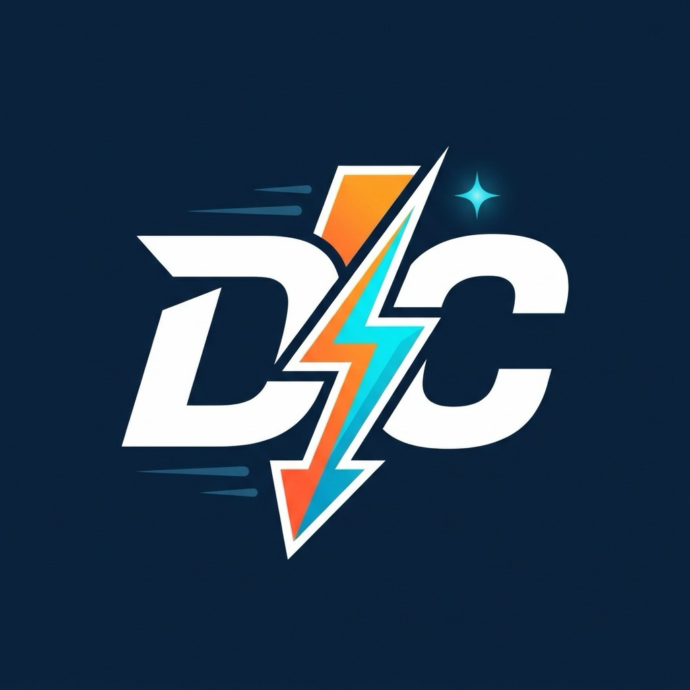
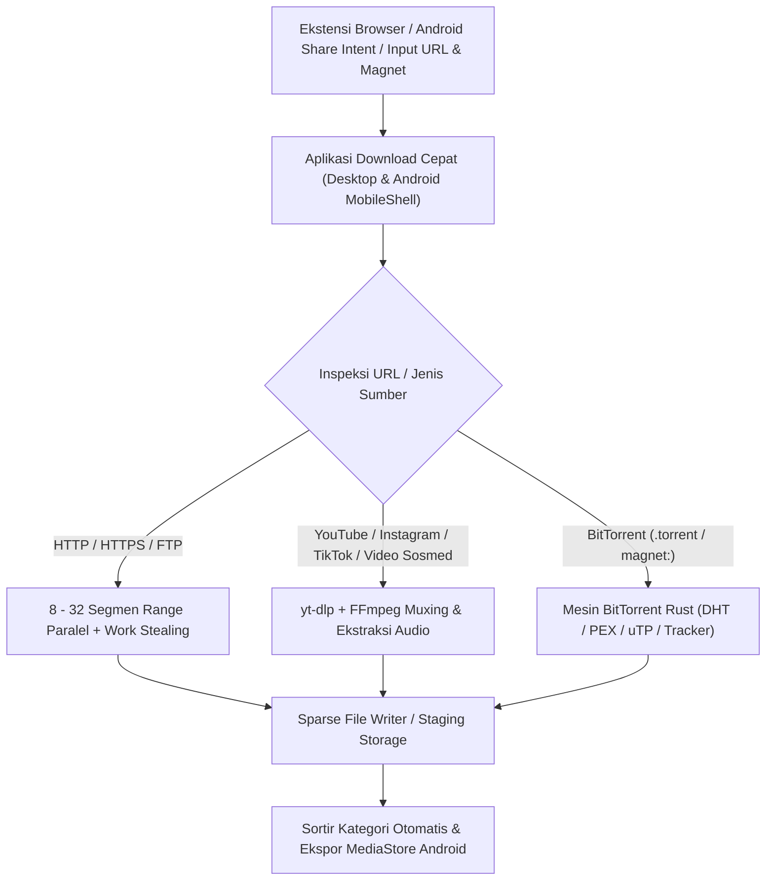

<div align="center">
  <p>🌐 <strong>Bahasa:</strong> <a href="README.md">English</a> | Bahasa Indonesia</p>

  
  <h1>Download Cepat ⚡</h1>
  <p><strong>Akselerator Unduhan Multi-Thread, Pengunduh Video Sosmed & Klien BitTorrent Lintas Platform (macOS, Windows, Linux & Android)</strong></p>
  <p>Dikembangkan secara resmi oleh <strong>Ujang Mustamar</strong></p>

  <p>
    <a href="https://github.com/moesstudio/download-cepat/releases">
      
    </a>
    
    
    
    
    
    
    
  </p>

  <p>
    <a href="https://github.com/moesstudio/download-cepat/releases/latest"><strong>📥 Unduh Installer & APK</strong></a> •
    <a href="https://chromewebstore.google.com/detail/lmahadjehdfibjjgcnbajbgapbkghida?utm_source=item-share-cb"><strong>🌐 Ekstensi Chrome</strong></a> •
    <a href="#-fitur-utama"><strong>✨ Fitur Utama</strong></a> •
    <a href="#-arsitektur-sistem"><strong>🏛️ Arsitektur</strong></a>
  </p>
</div>

---

## 📖 Tentang Download Cepat

**Download Cepat** adalah aplikasi akselerator dan pengelola unduhan *open-source* modern bertenaga **Rust (`tokio` + `reqwest`)**, **Tauri v2**, dan **React 19 (TypeScript & Tailwind CSS)** yang berjalan secara *native* di desktop maupun ponsel Android dari satu basis kode terpadu:

- **Lintas Platform Sejati**: Berjalan secara *native* di **macOS (Apple Silicon M1–M4 & Intel)**, **Windows 10/11**, **Linux**, dan **Android 8.0+ (API 26+)**.
- **Ringan & Hemat Sumber Daya**: Menggunakan memori di bawah **40 MB RAM** pada desktop tanpa *overhead* Electron yang boros memori.
- **Kecepatan Maksimal**: Membelah berkas menjadi 8 hingga 32 segmen koneksi HTTP Range secara paralel lengkap dengan *dynamic work-stealing* untuk memaksimalkan seluruh *bandwidth* internet Anda.
- **Pengunduh Video & Media Sosial Lengkap (`yt-dlp` + `FFmpeg`)**: Mengunduh video multi-resolusi (`144p` hingga `4K`/`8K`) maupun ekstraksi audio (`MP3 256kbps` & `M4A Original`) dari YouTube, Instagram, TikTok, Facebook, X/Twitter, Reddit, Vimeo, Twitch, Pinterest, Threads, SoundCloud, dan stream HLS/DASH di Desktop maupun Android.
- **Klien BitTorrent & `magnet:` Bawaan**: Mesin BitTorrent murni berbasis Rust dengan dukungan HTTP/UDP tracker, DHT, PEX, uTP (`BEP-29`), `ut_metadata` (`BEP-9`), dan pemilihan berkas multi-file.
- **100% Gratis & Bebas Iklan**: Tanpa iklan mengganggu, tanpa telemetri tersembunyi, dan tanpa *pop-up* nomor seri palsu.

---

## ✨ Fitur Utama

* 🚀 **Multi-Connection Segmented Download**: Mengakselerasi unduhan HTTP/HTTPS/FTP dengan membuka 8 hingga 32 koneksi Range simultan dan *dynamic work-stealing*.
* 🎬 **Pengunduh Video & Media Sosial (Desktop & Android)**: Inspeksi dan unduh video berbagai resolusi (`144p` s/d `8K` MP4) atau audio saja (`MP3 256kbps` & `M4A Original AAC`) dari YouTube, Instagram (Reels, Post, Carousel), TikTok, Facebook, X/Twitter, Reddit, Vimeo, Pinterest, Threads, dan stream HLS/DASH. Versi Android menyertakan Python 3.12 + `yt-dlp` + QuickJS + `FFmpeg` langsung di dalam APK lengkap dengan pembaruan ekstraktor `yt-dlp` otomatis di latar belakang.
* 🧲 **Klien BitTorrent & `magnet:` Terintegrasi**: Unduh berkas `.torrent` dan tautan `magnet:` langsung di aplikasi dengan dukungan DHT, PEX, UDP/HTTP tracker, uTP, dan pemilihan berkas.
* 📱 **Antarmuka Android Native (`MobileShell`)**: Desain *touch-first* responsif, integrasi **Android Share Sheet** (bagikan tautan langsung dari aplikasi YouTube, Instagram, TikTok, atau browser ke Download Cepat), notifikasi **Foreground Service** dengan info kecepatan *real-time* & tombol **Pause All**, serta ekspor otomatis ke folder publik `Downloads/Download Cepat/` via **MediaStore**.
* 🛡️ **Smart Pause, Resume & Refresh URL**: Melanjutkan unduhan yang terputus kapan saja tanpa risiko korupsi berkas berkat validasi header `If-Range` & `ETag`, serta fitur perbarui URL kedaluwarsa.
* ⚡ **Pre-Allocated Sparse File Assembly & Silent Pre-Buffer**: Menulis data langsung ke *byte offset* berkas final di disk (*zero-copy*) dan mulai mengunduh awal (*pre-buffer*) secara senyap saat jendela konfirmasi bergaya IDM tampil di desktop.
* 🌐 **Ekstensi Browser Manifest V3**: Mencegat unduhan dan stream video secara otomatis di Google Chrome, Microsoft Edge, Brave, dan Firefox via Native Messaging IPC & jembatan HTTP lokal.
* 📊 **Segmented Progress Bar & Real-time Canvas Graph**: Visualisasi dinamis pita segmen tiap koneksi aktif dan grafik kurva kecepatan *real-time*.
* 📁 **Kategorisasi Otomatis**: Berkas otomatis disortir ke folder kategori (*Compressed*, *Documents*, *Music*, *Programs*, *Video*, *Torrents*).
* 🔄 **In-App Auto-Update Terverifikasi SHA-256**: Pembaruan langsung dari dalam aplikasi untuk macOS, Windows, Linux, dan APK Android (`FileProvider` installer).
* 🌍 **Dukungan 16 Bahasa (Termasuk RTL)**: Tersedia dalam Bahasa Indonesia, English, Bahasa Melayu, 日本語, 简体中文, 繁體中文, 한국어, Español, Français, Deutsch, Português, Русский, العربية, हिन्दी, Tiếng Việt, dan ไทย.
* 🌙 **Mode Gelap & Terang**: Antarmuka bersih, elegan, dan mematuhi standar aksesibilitas WCAG 2.2 AA.

---

## 📦 Unduh Installer (macOS, Windows, Linux & Android)

👉 **[Unduh Rilis Terbaru di GitHub Releases](https://github.com/moesstudio/download-cepat/releases/latest)**

| Sistem Operasi | Format Installer | Arsitektur & Detail |
| :--- | :--- | :--- |
| 🤖 **Android (8.0+)** | `.apk` (`arm64-v8a` & `universal`) | **ARM64** (`Download.Cepat_1.0.5_arm64-v8a.apk`, disarankan untuk HP Android modern) & **Universal** (`arm64-v8a` + `armeabi-v7a`) lengkap dengan `yt-dlp` + `FFmpeg` tertanam |
| 🍏 **macOS** | `.dmg` / `.app.tar.gz` | Apple Silicon (M1–M4) & Intel lengkap dengan In-App Auto-Update |
| 🪟 **Windows** | `.exe` (NSIS Setup) / `.msi` | Windows 10 & 11 (64-bit) dengan *auto-uninstaller* bersih |
| 🐧 **Linux** | `.AppImage` / `.deb` / `.rpm` | Paket untuk Ubuntu, Debian, Fedora, RHEL, dan Arch |

*(Catatan: Pada Android, izinkan "Install unknown apps" saat memasang berkas `.apk` dari browser atau file manager. Pada Windows SmartScreen atau macOS Gatekeeper, klik **More info → Run anyway** di Windows, atau klik kanan → **Open** di macOS).*

### 🛠️ Membangun Installer Desktop & APK Android Mandiri (Local Build)

```bash
# 1. Bangun aplikasi desktop dan bundler native OS saat ini (macOS / Windows / Linux)
npm run desktop:build

# 2. Bangun APK rilis Android tertandatangani (arm64-v8a & universal)
./scripts/build-android.sh
# Hasil APK tersimpan di:
# - installer/Download Cepat_1.0.5_arm64-v8a.apk
# - installer/Download Cepat_1.0.5_universal.apk
```

Repositori ini juga dilengkapi otomasi **GitHub Actions CI/CD Release Matrix** (`.github/workflows/release.yml`) yang mengompilasi installer untuk **macOS, Windows, Linux, dan Android** secara otomatis setiap kali tag rilis dibuat.

---

## 🏛️ Arsitektur Sistem



---

## 🚀 Memulai (Quick Start)

### Prasyarat
- **Node.js** v18+ dan `npm`
- **Rust** 1.80+ (`cargo`)
- *(Opsional untuk build Android)*: **Android SDK** (API 35/36), **NDK r27c**, dan **JDK 21**

### 1. Kloning Repositori
```bash
git clone https://github.com/moesstudio/download-cepat.git
cd download-cepat
```

### 2. Menjalankan Dashboard Antarmuka (GUI)
```bash
# Pasang dependensi
npm install

# Jalankan server pengembangan
npm run dev
```
Buka browser di `http://localhost:1420` untuk melihat dashboard Download Cepat.

### 3. Menguji Mesin Download Paralel (Rust CLI)
```bash
# Kompilasi & jalankan uji coba download 8 koneksi paralel
cargo run --bin download-cepat-cli --manifest-path core-engine/Cargo.toml -- "https://raw.githubusercontent.com/rust-lang/rust/master/README.md"
```

### 4. Memasang Ekstensi Browser (Desktop)

**Cara Termudah (Resmi Chrome Web Store)**:
👉 **[Pasang Download Cepat Integration Module di Chrome Web Store](https://chromewebstore.google.com/detail/lmahadjehdfibjjgcnbajbgapbkghida?utm_source=item-share-cb)** *(ID: `lmahadjehdfibjjgcnbajbgapbkghida`)*

**Cara Manual / Pengembang (Offline)**:
1. Buka Google Chrome / Edge / Brave dan navigasikan ke `chrome://extensions/`.
2. Aktifkan **Developer mode** di pojok kanan atas.
3. Klik tombol **Load unpacked** dan pilih folder `extension/`.

---

## 🧪 Pengujian & Kualitas Kode

Proyek ini dilengkapi dengan rangkaian pengujian otomatis unit, integrasi, dan UI:

```bash
# Menjalankan pengujian komponen UI (Vitest — 38 tes)
npx vitest run

# Menjalankan pengujian mesin inti Rust (29 tes unit & integrasi)
cargo test --manifest-path core-engine/Cargo.toml

# Menjalankan pengujian backend aplikasi Tauri (14 tes)
cargo test --manifest-path src-tauri/Cargo.toml

# Memeriksa build produksi frontend
npm run build
```

---

## 📁 Struktur Direktori

```text
download-cepat/
├── core-engine/               # Mesin unduh inti bertenaga Rust (Tokio, Reqwest, Rusqlite)
│   ├── src/bin/cli.rs         # Antarmuka CLI pengujian mandiri
│   ├── src/downloader.rs      # Engine multi-thread HTTP Range, work-stealing & sparse file writer
│   ├── src/inspector.rs       # Pemeriksa HTTP HEAD, MIME-type, & nama berkas
│   ├── src/torrent.rs         # Mesin BitTorrent & magnet: native (DHT, PEX, uTP, tracker)
│   ├── src/video_runtime.rs   # Runtime video/stream, helper provisioning yt-dlp & FFmpeg
│   ├── src/updater.rs         # Auto-updater SHA-256 lintas platform & APK Android
│   ├── src/storage.rs         # Database SQLite lokal untuk riwayat & antrean
│   └── tests/engine_tests.rs  # Rangkaian tes integrasi mesin
│
├── src-tauri/                 # Tauri v2 Native Shell (Desktop & Android)
│   ├── src/lib.rs             # Command Tauri, orkestrasi video/torrent, popup prebuffer & tray
│   ├── src/android_bridge.rs  # Bridge Rust <-> Kotlin untuk intent Android, FGS, MediaStore & yt-dlp
│   └── gen/android/           # Proyek Gradle Android (MainActivity, DownloadBridgePlugin, FGS)
│
├── src/                       # Antarmuka Dashboard (React 19 + TypeScript + Tailwind)
│   ├── components/            # Komponen UI Desktop & MobileShell Android
│   ├── i18n/                  # Kamus lokalisasi 16 bahasa
│   ├── App.tsx                # Pengendali utama shell desktop & mobile
│   └── test/                  # Rangkaian tes Vitest UI & ekstensi
│
├── scripts/
│   └── build-android.sh       # Skrip build otomatis APK arm64-v8a & universal + verifikasi signature
│
├── extension/                 # Ekstensi Browser resmi (Manifest V3)
├── public/                    # Aset publik & logo vektor
└── tailwind.config.js         # Konfigurasi Tailwind CSS
```

---

## 📄 Lisensi & Pencipta

Dikembangkan oleh **Ujang Mustamar**.  
Didistribusikan di bawah lisensi **MIT**. Lihat file `LICENSE` untuk informasi lebih lanjut.
