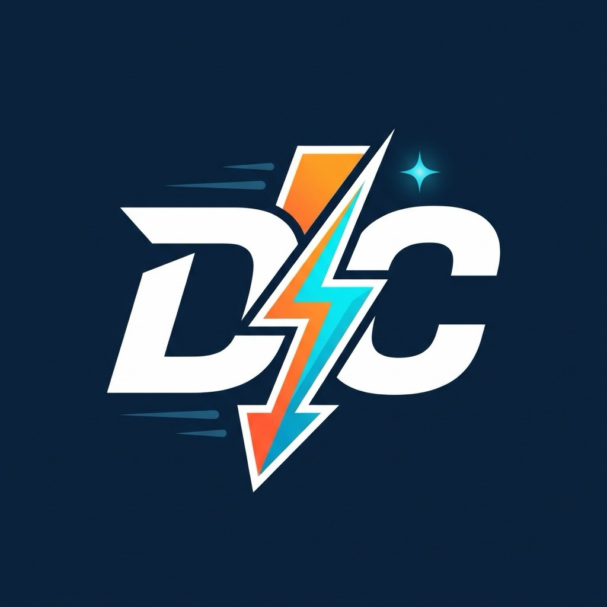
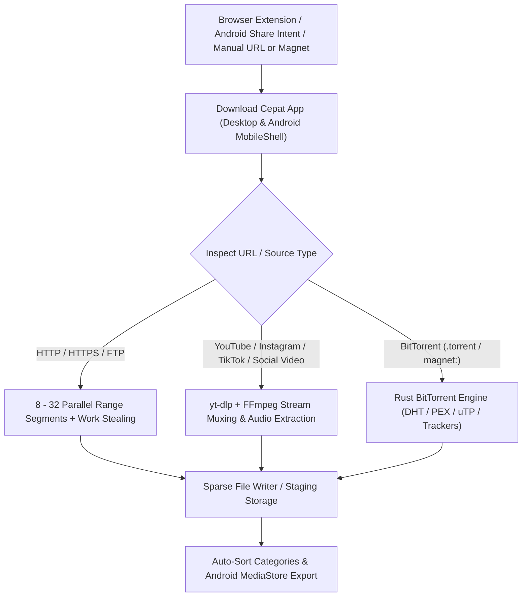

<div align="center">
  <p>🌐 <strong>Language:</strong> English | <a href="README.id.md">Bahasa Indonesia</a></p>

  
  <h1>Download Cepat ⚡</h1>
  <p><strong>A Modern, Cross-Platform Multi-Thread Download Accelerator, Video Grabber & BitTorrent Manager (macOS, Windows, Linux & Android)</strong></p>
  <p>Officially developed by <strong>Ujang Mustamar</strong></p>

  <p>
    <a href="https://github.com/moesstudio/download-cepat/releases">
      
    </a>
    
    
    
    
    
    
    
  </p>

  <p>
    <a href="https://github.com/moesstudio/download-cepat/releases/latest"><strong>📥 Download Installer & APK</strong></a> •
    <a href="https://chromewebstore.google.com/detail/lmahadjehdfibjjgcnbajbgapbkghida?utm_source=item-share-cb"><strong>🌐 Chrome Extension</strong></a> •
    <a href="#-key-features"><strong>✨ Features</strong></a> •
    <a href="#-system-architecture"><strong>🏛️ Architecture</strong></a>
  </p>
</div>

---

## 📖 About Download Cepat

*(Fun fact: "Download Cepat" literally means "Fast Download" in Indonesian.)*

**Download Cepat** is a modern, open-source download accelerator and media manager powered by **Rust (`tokio` + `reqwest`)**, **Tauri v2**, and **React 19 (TypeScript & Tailwind CSS)**. It runs natively across desktop and mobile from a unified codebase:

- **True Cross-Platform Support**: Runs natively on **macOS (Universal: Apple Silicon M1–M4 & Intel)**, **Windows 10/11**, **Linux**, and **Android 8.0+ (API 26+)**.
- **Ultra-Lightweight & Resource-Efficient**: Consumes under **40 MB of RAM** on desktop with a tiny native binary footprint (no bloated Electron memory overhead).
- **Maximum Bandwidth Utilization**: Splits files into 8 to 32 concurrent HTTP Range segments with dynamic work-stealing to saturate your internet connection.
- **Full Social Media & Video Engine (`yt-dlp` + `FFmpeg`)**: Download videos and extract MP3/M4A audio from YouTube, Instagram, TikTok, Facebook, X/Twitter, Reddit, Vimeo, Twitch, Pinterest, Threads, SoundCloud, and HLS/DASH streams on both Desktop and Android.
- **Native BitTorrent & `magnet:` Client**: Pure-Rust BitTorrent engine supporting HTTP/UDP trackers, DHT, PEX, uTP (`BEP-29`), `ut_metadata` (`BEP-9`), and multi-file selection.
- **100% Free & Ad-Free**: No intrusive ads, no telemetry, and no fake serial number pop-ups.

---

## ✨ Key Features

* 🚀 **Multi-Connection Segmented Download**: Accelerates HTTP/HTTPS/FTP downloads by opening 8 to 32 simultaneous Range connections with dynamic work-stealing.
* 🎬 **Social Media & Video Downloader (Desktop & Android)**: Inspect and download multi-resolution video (`144p` up to `4K`/`8K` MP4) or audio-only (`MP3 256kbps` & `M4A Original AAC`) from YouTube, Instagram (Reels, Posts, Carousels), TikTok, Facebook, X/Twitter, Reddit, Vimeo, Pinterest, Threads, and HLS/DASH manifests. Android bundles embedded Python 3.12 + `yt-dlp` + QuickJS + `FFmpeg` directly inside the APK with automatic background `yt-dlp` extractor updates.
* 🧲 **Built-In BitTorrent & `magnet:` Engine**: Download `.torrent` files and `magnet:` links with DHT, PEX, UDP/HTTP trackers, uTP, and per-file selection.
* 📱 **Native Android Experience (`MobileShell`)**: Touch-first responsive UI, Android Share Sheet integration (share links directly from YouTube, Instagram, TikTok, or browsers into Download Cepat), background **Foreground Service** notification with real-time speed and **Pause All** action, and automatic **MediaStore** export to public `Downloads/Download Cepat/`.
* 🛡️ **Smart Pause, Resume & Refresh URL**: Safely resume interrupted downloads anytime without file corruption using strict `If-Range` & `ETag` validation, or refresh expired signed URLs in place.
* ⚡ **Pre-Allocated Sparse File Assembly & Silent Pre-Buffer**: Writes incoming chunks directly to their final byte offsets on disk (zero-copy) and starts pre-buffering downloads in the background while the IDM-style confirmation popup is open on desktop.
* 🌐 **Manifest V3 Browser Extension**: Automatically intercepts downloads and video streams across Google Chrome, Microsoft Edge, Brave, and Firefox via Native Messaging IPC & local HTTP bridge.
* 📊 **Segmented Progress Bar & Real-Time Canvas Graph**: Dynamic per-segment progress visualization alongside a live speed curve graph.
* 📁 **Automatic File Categorization**: Organizes completed downloads into dedicated folders (*Compressed*, *Documents*, *Music*, *Programs*, *Video*, *Torrents*).
* 🔄 **SHA-256 Verified In-App Auto-Updater**: One-click in-app updates for macOS, Windows, Linux, and Android APK (`FileProvider` package installer).
* 🌍 **16-Language Interface (with RTL Support)**: Available in English, Bahasa Indonesia, Bahasa Melayu, 日本語, 简体中文, 繁體中文, 한국어, Español, Français, Deutsch, Português, Русский, العربية, हिन्दी, Tiếng Việt, and ไทย.
* 🌙 **Dark & Light Mode**: Clean, accessible interface adhering to WCAG 2.2 AA contrast standards.

---

## 📦 Download Installers (macOS, Windows, Linux & Android)

👉 **[Download the Latest Release from GitHub Releases](https://github.com/moesstudio/download-cepat/releases/latest)**

| Platform | Installer Format | Architecture & Details |
| :--- | :--- | :--- |
| 🤖 **Android (8.0+)** | `.apk` (`arm64-v8a` & `universal`) | **ARM64** (`Download.Cepat_1.0.5_arm64-v8a.apk`, recommended for modern phones) & **Universal** (`arm64-v8a` + `armeabi-v7a`) with embedded `yt-dlp` + `FFmpeg` |
| 🍏 **macOS** | `.dmg` / `.app.tar.gz` | Native Apple Silicon (M1–M4) & Intel with In-App Auto-Update |
| 🪟 **Windows** | `.exe` (NSIS Setup) / `.msi` | Windows 10 & 11 (64-bit) with clean auto-uninstaller |
| 🐧 **Linux** | `.AppImage` / `.deb` / `.rpm` | Packages for Ubuntu, Debian, Fedora, RHEL, and Arch |

*(Note: On Android, allow "Install unknown apps" when installing the `.apk` directly from your browser or file manager. On Windows SmartScreen or macOS Gatekeeper, click **More info → Run anyway** on Windows, or right-click → **Open** on macOS).*

### 🛠️ Building Desktop & Android Installers Locally

```bash
# 1. Build the desktop application and native OS bundler (macOS / Windows / Linux)
npm run desktop:build

# 2. Build signed Android release APKs (arm64-v8a & universal)
./scripts/build-android.sh
# Output APKs are generated in:
# - installer/Download Cepat_1.0.5_arm64-v8a.apk
# - installer/Download Cepat_1.0.5_universal.apk
```

This repository is configured with a **GitHub Actions CI/CD Release Matrix** (`.github/workflows/release.yml`) that compiles installers for **macOS, Windows, Linux, and Android** on every release tag.

---

## 🏛️ System Architecture



---

## 🚀 Quick Start (Development)

### Prerequisites
- **Node.js** v18+ and `npm`
- **Rust** 1.80+ (`cargo`)
- *(Optional for Android builds)*: **Android SDK** (API 35/36), **NDK r27c**, and **JDK 21**

### 1. Clone the Repository
```bash
git clone https://github.com/moesstudio/download-cepat.git
cd download-cepat
```

### 2. Run the UI Dashboard (GUI)
```bash
# Install dependencies
npm install

# Start the development server
npm run dev
```
Open your browser at `http://localhost:1420` to view the Download Cepat dashboard.

### 3. Test the Parallel Download Engine (Rust CLI)
```bash
# Compile & run an 8-connection parallel download test
cargo run --bin download-cepat-cli --manifest-path core-engine/Cargo.toml -- "https://raw.githubusercontent.com/rust-lang/rust/master/README.md"
```

### 4. Install the Browser Extension (Desktop)

**Easiest Method (Official Chrome Web Store)**:
👉 **[Install Download Cepat Integration Module on Chrome Web Store](https://chromewebstore.google.com/detail/lmahadjehdfibjjgcnbajbgapbkghida?utm_source=item-share-cb)** *(Extension ID: `lmahadjehdfibjjgcnbajbgapbkghida`)*

**Manual / Developer Method (Offline)**:
1. Open Google Chrome, Microsoft Edge, or Brave and navigate to `chrome://extensions/`.
2. Enable **Developer mode** in the top-right corner.
3. Click **Load unpacked** and select the `extension/` directory.

---

## 🧪 Testing & Code Quality

This project includes automated unit, integration, and UI test suites:

```bash
# Run UI component tests (Vitest — 38 tests)
npx vitest run

# Run Rust core engine tests (29 unit & integration tests)
cargo test --manifest-path core-engine/Cargo.toml

# Run Tauri application backend tests (14 tests)
cargo test --manifest-path src-tauri/Cargo.toml

# Verify production frontend build
npm run build
```

---

## 📁 Directory Structure

```text
download-cepat/
├── core-engine/               # Core download engine powered by Rust (Tokio, Reqwest, Rusqlite)
│   ├── src/bin/cli.rs         # Standalone CLI testing interface
│   ├── src/downloader.rs      # Multi-thread HTTP Range engine, work-stealing & sparse file writer
│   ├── src/inspector.rs       # HTTP HEAD, MIME-type, & filename inspector
│   ├── src/torrent.rs         # Native BitTorrent & magnet: engine (DHT, PEX, uTP, trackers)
│   ├── src/video_runtime.rs   # Video/stream runtime, yt-dlp & FFmpeg provisioning helpers
│   ├── src/updater.rs         # Cross-platform & Android APK SHA-256 auto-updater
│   ├── src/storage.rs         # Local SQLite database for download history & queues
│   └── tests/engine_tests.rs  # Engine integration test suite
│
├── src-tauri/                 # Tauri v2 Native Shell (Desktop & Android)
│   ├── src/lib.rs             # Commands, video/torrent orchestration, popup prebuffer & tray
│   ├── src/android_bridge.rs  # Rust <-> Kotlin bridge for Android intents, FGS, MediaStore & yt-dlp
│   └── gen/android/           # Android Gradle project (MainActivity, DownloadBridgePlugin, FGS)
│
├── src/                       # Frontend Dashboard UI (React 19 + TypeScript + Tailwind)
│   ├── components/            # Desktop & MobileShell UI components
│   ├── i18n/                  # 16-language localization dictionaries
│   ├── App.tsx                # Unified desktop & mobile shell controller
│   └── test/                  # Vitest UI & extension test suites
│
├── scripts/
│   └── build-android.sh       # Automated Android arm64-v8a & universal APK build + signature verifier
│
├── extension/                 # Official Browser Extension (Manifest V3)
├── public/                    # Public assets & vector logos
└── tailwind.config.js         # Tailwind CSS configuration
```

---

## 🤝 Contributing

Contributions, bug reports, and feature requests are warmly welcome!

1. **Fork** the repository.
2. Create your feature branch (`git checkout -b feature/your-feature`).
3. **Commit** your changes (`git commit -m 'Add your feature'`).
4. **Push** to the branch (`git push origin feature/your-feature`).
5. Open a **Pull Request**.

---

## 📄 License & Author

Developed by **Ujang Mustamar**.  
Distributed under the **MIT** License. See `LICENSE` for more information.
