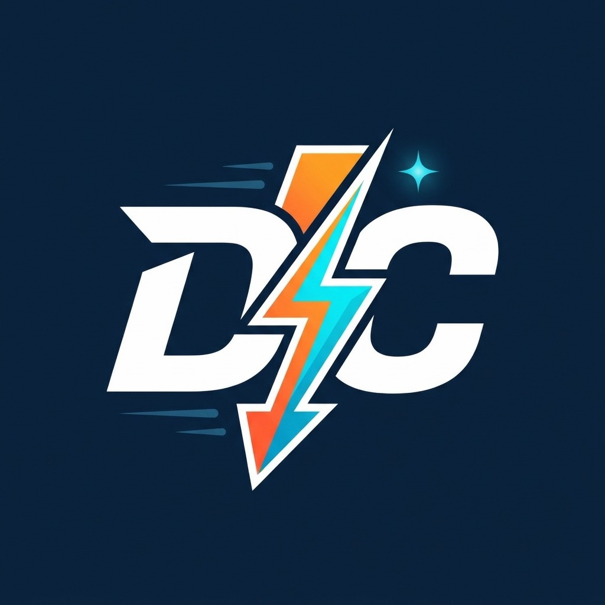
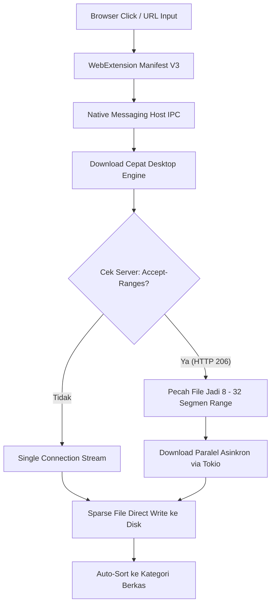

<div align="center">
  
  <h1>Download Cepat ⚡</h1>
  <p><strong>Akselerator & Pengelola Unduhan Multi-Thread Modern Lintas Platform (macOS & Windows)</strong></p>
  <p>Dikembangkan secara resmi oleh <strong>Ujang Mustamar</strong></p>

  <p>
    
    
    
    
    
    
    
  </p>
</div>

---

## 📖 Tentang Download Cepat

**Download Cepat** adalah aplikasi download manager modern bertenaga **Rust (`tokio` + `reqwest`)** dan **React 19 (TypeScript & Tailwind CSS)** yang dirancang untuk mengatasi kelemahan download manager tradisional:
- **Hadir Lintas Platform**: Berjalan secara *native* di **macOS (Universal: Apple Silicon M1–M4 & Intel)** serta **Windows 10/11**.
- **Ringan & Hemat Daya**: Menggunakan memori di bawah 40 MB RAM dan ukuran biner rilis hanya **4.4 MB** (bukan aplikasi Electron yang boros memori).
- **Kecepatan Maksimal**: Membelah file menjadi 8 hingga 32 segmen koneksi HTTP Range secara paralel untuk memaksimalkan seluruh *bandwidth* internet Anda.

---

## ✨ Fitur Utama

* 🚀 **Multi-Connection Segmented Download**: Mengunduh berkas dengan membuka 8 hingga 32 koneksi HTTP Range simultan.
* 🛡️ **Smart Pause & Resume**: Melanjutkan unduhan yang terputus kapan saja tanpa risiko korupsi file dengan validasi header `If-Range` & `ETag`.
* ⚡ **Pre-Allocated Sparse File Assembly**: Menulis data secara langsung ke *byte offset* file final di disk (zero-copy), mencegah sistem *freeze* saat menyelesaikan file berukuran belasan gigabyte.
* 🌐 **Ekstensi Browser Manifest V3**: Mencegat unduhan secara otomatis di Google Chrome, Microsoft Edge, dan Firefox via Native Messaging IPC.
* 🎥 **Floating Video Grabber**: Menampilkan tombol unduh melayang otomatis di atas video streaming HTML5.
* 📊 **Segmented Progress Bar & Real-time Canvas Graph**: Visualisasi dinamis pita segmen tiap koneksi aktif dan grafik kurva Mbps *real-time*.
* 📁 **Kategorisasi Otomatis**: Berkas otomatis disortir ke folder kategori (*Compressed*, *Documents*, *Music*, *Programs*, *Video*).
* 🎛️ **Speed Limiter Pintar**: Batasi kecepatan unduhan agar aktivitas browsing, streaming, atau gaming tetap lancar.
* 🌍 **Dukungan Multi-Bahasa**: Antarmuka tersedia dalam Bahasa Indonesia, English, Bahasa Melayu, dan 日本語.
* 🪪 **Build Info Resmi**: Panel informasi rilis, lisensi MIT, versi engine, serta atribusi resmi atas nama **Ujang Mustamar**.
* 🌙 **Mode Gelap & Terang**: Antarmuka bersih, elegan, dan mematuhi standar aksesibilitas WCAG 2.2 AA.

---

## 📦 Unduh Installer Desktop (macOS, Windows, Linux)

Aplikasi desktop resmi **Download Cepat** dikompilasi menggunakan arsitektur **Tauri v2 + Rust Core** sehingga sangat ringan (~3.2 MB installer) dan hemat memori (< 40 MB RAM):

| Sistem Operasi | Format Installer | Fitur & Arsitektur |
| :--- | :--- | :--- |
| 🍏 **macOS** | `.dmg` / `.app` | Apple Silicon (M1–M4) & Intel x86_64 |
| 🪟 **Windows** | `.exe` (NSIS Setup) / `.msi` | Windows 10 & 11 (64-bit) dengan auto-uninstaller |
| 🐧 **Linux** | `.AppImage` / `.deb` | Universal portable untuk Ubuntu, Debian, Fedora, Arch |

### 🛠️ Membangun Installer Desktop Mandiri (Local Build)
```bash
# Bangun aplikasi desktop dan bundler native OS saat ini
npm run desktop:build

# Hasil installer tersimpan di:
# - macOS: src-tauri/target/release/bundle/dmg/Download Cepat_1.0.0_aarch64.dmg
# - Windows: src-tauri/target/release/bundle/nsis/Download Cepat_1.0.0_x64-setup.exe
# - Linux: src-tauri/target/release/bundle/appimage/ & bundle/deb/
```

Selain build lokal, repositori ini telah dilengkapi otomasi **GitHub Actions CI/CD Release Matrix** (`.github/workflows/release.yml`) yang secara otomatis mengompilasi seluruh installer untuk ketiga platform tersebut secara bersamaan.

---

## 🏛️ Arsitektur Sistem



---

## 🚀 Memulai (Quick Start)

### Prasyarat
- **Node.js** v18+ dan `npm`
- **Rust** 1.80+ (`cargo`)

### 1. Kloning Repositori
```bash
git clone https://github.com/moesstudio/download-cepat.git
cd download-cepat
```

### 2. Menjalankan Dashboard Antarmuka (GUI)
```bash
# Pasang dependensi
npm install

# Jalankan server pengembangan
npm run dev
```
Buka browser di `http://localhost:1420` untuk melihat dashboard Download Cepat.

### 3. Menguji Mesin Download Paralel (Rust CLI)
```bash
# Kompilasi & jalankan uji coba download 8 koneksi paralel
cargo run --bin download-cepat-cli --manifest-path core-engine/Cargo.toml -- "https://raw.githubusercontent.com/rust-lang/rust/master/README.md"
```

### 4. Memasang Ekstensi Browser
1. Buka Google Chrome / Edge dan navigasikan ke `chrome://extensions/`.
2. Aktifkan **Developer mode** di pojok kanan atas.
3. Klik tombol **Load unpacked** dan pilih folder `extension/`.

---

## 🧪 Pengujian & Kualitas Kode

Proyek ini dilengkapi dengan rangkaian pengujian otomatis unit, integrasi, dan UI:

```bash
# Menjalankan pengujian komponen UI (Vitest)
npx vitest run

# Menjalankan pengujian mesin Rust
cargo test --manifest-path core-engine/Cargo.toml

# Memeriksa build produksi
npm run build
```

---

## 📁 Struktur Direktori

```
download-cepat/
├── core-engine/               # Mesin unduh inti bertenaga Rust (Tokio, Reqwest, Rusqlite)
│   ├── src/bin/cli.rs         # Antarmuka CLI pengujian mandiri
│   ├── src/downloader.rs      # Engine multi-thread HTTP Range & sparse file writing
│   ├── src/inspector.rs       # Pemeriksa HTTP HEAD, MIME-type, & nama berkas
│   ├── src/storage.rs         # Database SQLite lokal untuk riwayat & antrean
│   └── tests/engine_tests.rs  # Rangkaian tes integrasi mesin
│
├── src/                       # Antarmuka Dashboard (React 19 + TypeScript + Tailwind)
│   ├── components/            # Komponen UI: SegmentedProgressBar, SpeedGraphCanvas, dll.
│   ├── App.tsx                # Komponen utama desktop shell
│   └── test/                  # Rangkaian tes Vitest
│
├── extension/                 # Ekstensi Browser resmi (Manifest V3)
│   ├── manifest.json
│   ├── background.js          # Service worker pencegat unduhan
│   ├── content.js             # Skrip penyuntik tombol download video streaming
│   └── popup.html             # Popup status ekstensi
│
├── public/                    # Aset publik & logo vektor
└── tailwind.config.js         # Konfigurasi Tailwind CSS
```

---

## 📄 Lisensi & Pencipta

Dikembangkan oleh **Ujang Mustamar**.  
Didistribusikan di bawah lisensi **MIT**. Lihat file `LICENSE` untuk informasi lebih lanjut.
